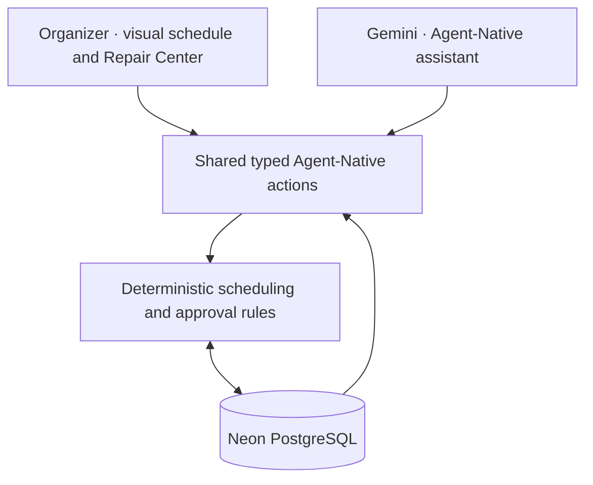

# CrewCover

**When your crew changes, your plan doesn't have to.**

CrewCover is an **agent-native emergency staffing recovery workspace** for event organizers. When a volunteer cancels, it identifies uncovered positions, evaluates qualified replacements, and helps the organizer repair the schedule—with people approving the changes that matter.

Built with **[Builder.io Agent-Native](https://www.agent-native.com/)** for the **Builder.io Agent-Native Hackathon 2026**.

**[Explore CrewCover](https://crewcover-iota.vercel.app)** · **[Judge walkthrough](docs/JUDGE_WALKTHROUGH.md)** · **[Architecture](docs/ARCHITECTURE.md)** · **[Verified tests](docs/TESTING.md)**

> **Demo access:** CrewCover currently uses authenticated organizer workspaces. Create an account or sign in, then choose **Open demo conference**. The conference, volunteers, and scenario are fictional; the scheduling operations and database changes are real.
>
> **Clips demonstration:** A public recording link will be added once it has been recorded and verified.

## The problem: a schedule can break in minutes

Consider a conference with twenty volunteers assigned across registration, safety, technical support, guest assistance, and other critical functions. Shortly before the doors open, three volunteers cancel.

The organizer now has to determine **which positions are uncovered**, find people with the **right skills and availability**, check for **overlapping assignments and hour limits**, decide whom to move, and document the final decisions. A simple roster shows the vacancies, but it does not necessarily help the organizer work through the recovery.

That is the problem CrewCover was built to address: **the coordination work that begins when a staffing plan stops matching reality.**

## Why we built CrewCover

We wanted to make schedule recovery a focused, usable workflow rather than a collection of disconnected spreadsheets, messages, and last-minute guesses.

The goal is not to remove the organizer from the process. It is to reduce repetitive checking and make the important decisions easier to inspect:

- **Software handles** gap detection, eligibility checks, candidate ranking, coverage calculations, and audit records.
- **The agent helps** interpret the situation, retrieve current event facts, initiate repair proposals, and explain options.
- **The organizer decides** which proposed changes should actually take effect.

CrewCover is designed around that division of responsibility.

## The solution: from cancellation to a reviewed repair

1. **See the current plan.** A visual schedule shows staffing by role and time slot, with a live coverage summary.
2. **Record a cancellation.** Uncovered positions become visible, and coverage is recalculated from persisted assignments.
3. **Find valid replacements.** A deterministic engine checks required qualifications, full-shift availability, overlapping assignments, cancellation intervals, and working-hour limits.
4. **Investigate with the agent.** Gemini uses registered Agent-Native actions to read the current event and generate a repair proposal, rather than inventing assignments in chat.
5. **Review before applying.** The organizer can inspect recommendations, reasons, and unresolved gaps. A pending proposal does **not** change the schedule.
6. **Approve and recover.** On approval, the system revalidates the proposal, saves assignments transactionally, recalculates coverage, and records the decision in Activity.

If nobody meets the constraints, CrewCover leaves the position unresolved instead of suggesting an invalid replacement.

### How CrewCover reduces manual effort

| Coordination task | Without a recovery workflow | With CrewCover |
| --- | --- | --- |
| Identify affected positions | Examine shifts and assignments manually | Recalculate and display uncovered positions |
| Check potential replacements | Compare skills, availability, and schedules person by person | Validate and rank candidates against explicit rules |
| Spot scheduling conflicts | Cross-check overlapping shifts and hour totals | Reject conflicting assignments |
| Compare recovery options | Assemble a replacement plan manually | Review a generated proposal with eligibility reasons |
| Update and document decisions | Edit records and reconstruct what happened | Apply approved changes and maintain an activity history |

These are **workflow capabilities, not measured time-savings claims**. CrewCover does not currently contact volunteers, verify that they accept replacement shifts, or send notifications. The organizer remains responsible for real-world coordination.

## What makes CrewCover different

**Recovery first, not just roster management.** Its central experience is responding to a broken schedule: detect the gaps, evaluate a repair, approve it, and verify the result.

**An agent that works with the same records as the interface.** Gemini and React use the same typed Agent-Native action contracts and persisted event state. A manual schedule change is available to the agent on its next fresh read.

**Explainable, constraint-based recommendations.** Candidate suitability comes from deterministic checks, not unverified model intuition. The Repair Center shows recommendation reasons and unresolved gaps.

**Human approval is part of the workflow.** Proposals remain pending until approved. Revision checks and transaction-level safeguards reject stale, duplicate, or conflicting applications.

**A usable result, not just an AI conversation.** Coverage, assignments, volunteer profiles, repairs, and activity are visible in a purpose-built operations workspace.

These are CrewCover's design distinctions; they are not a claim that no other scheduling product offers similar capabilities.

## Why Builder.io Agent-Native?

We built CrewCover for the **Builder.io Agent-Native Hackathon** because its core challenge is about people and agents working through **shared application capabilities**, not placing a chatbot next to a dashboard.

CrewCover extends the official standalone Agent-Native Chat starter:

- **Shared actions:** Operations in `actions/` use typed `defineAction()` contracts. The interface calls them via `useActionQuery` and `useActionMutation`; the agent uses the same action registry.
- **Shared context:** The selected event and workspace view are available to the agent, while coverage actions retrieve fresh persisted facts.
- **Reliable business rules:** `shared/scheduling.ts` evaluates staffing constraints; Gemini explains and orchestrates actions but does not bypass validation.
- **Controlled changes:** Organizer identity, approval requirements, schedule revisions, and database transactions govern what can be committed.
- **Persistent state:** Neon PostgreSQL stores the schedule, decisions, and audit history, so results survive a refresh.



For implementation details and live action evidence, see **[Agent-Native integration](docs/AGENT_NATIVE_INTEGRATION.md)**.

## Working demonstration: three cancellations, one recovery

The reproducible **Gather 2026** scenario begins with twenty fictional volunteers, ten shifts, and twenty staffed positions.

| Verified step | Coverage |
| --- | ---: |
| Initial event schedule | **100%** |
| Three morning volunteers cancel | **85%** |
| Agent generates a proposal, awaiting approval | **85%** |
| Organizer approves qualified replacements | **100%** |

The production verification also exercised a subsequent manual assignment, followed by a fresh Gemini tool call reading the updated schedule.

### Try it yourself

1. Open **[CrewCover](https://crewcover-iota.vercel.app)** and sign in or create an account.
2. Choose **Open demo conference**. If the event was previously changed, select **Reset demo → Reset conference**.
3. On **Schedule**, cancel the morning assignments for **Ada Okafor**, **Noah Patel**, and **Mia Chen**. Coverage falls to 85%.
4. Ask the agent: *“Three volunteers have cancelled. Find qualified replacements without double-booking anyone. Generate a proposal, but do not approve it.”*
5. Open **Repair Center**, inspect the reasons, then select **Review & approve → Approve & apply repair**.
6. Confirm recovered coverage, refresh the page, and inspect **Activity**. Try a validated manual assignment and ask the agent to recheck coverage.

**The volunteers and event are synthetic.** The action execution, constraints, persistence, approvals, and reported coverage are backed by the running application. See the **[timed Clips walkthrough](docs/JUDGE_WALKTHROUGH.md)**.

## Features in the verified release

- Private organizer workspace and repeatable fictional event
- Visual role-by-time schedule with live coverage and critical gaps
- Volunteer directory with editable skills, availability, and hour limits
- Confirmed cancellations and validated manual vacancy assignment
- Ranked replacement recommendations, reasons, and unresolved gaps
- Pending proposals with explicit approve/reject decisions
- Persistent activity history and transaction-safe schedule changes
- Context-aware Gemini agent using genuine Agent-Native actions
- Authentication, owner-scoped data access, and persisted inference budgets
- Responsive interface, accessible controls, and reduced-motion support

## Technology

| Layer | Implementation |
| --- | --- |
| Agent-native framework | Builder.io Agent-Native, official standalone Chat starter |
| Frontend | React, React Router, TypeScript |
| Runtime and build | Vite, Nitro, Node.js 24 |
| AI | Google Gemini; OpenRouter is an optional manually selected alternative |
| Scheduling | Deterministic TypeScript rules and transactional approvals |
| Persistence | Neon PostgreSQL through the framework database adapter |
| Deployment | Vercel |
| Validation | Unit/database tests, Playwright browser tests, Agent-Native Doctor, Axe |

No VPS, Redis instance, paid messaging service, or blockchain infrastructure is required for the MVP.

## Run locally

Use **Node.js 24.22.2** and the repository-pinned **pnpm 10.29.1**.

```bash
nvm use
corepack pnpm install --frozen-lockfile
cp .env.example .env
# Add server-only credentials to .env; never commit them.
corepack pnpm migrate:production
corepack pnpm dev
```

Required server-side environment variables:

```dotenv
DATABASE_URL=
BETTER_AUTH_SECRET=
GOOGLE_GENERATIVE_AI_API_KEY=
```

Optional variables include `DATABASE_URL_UNPOOLED` for an appropriate direct migration connection, `BETTER_AUTH_URL` where needed, and `OPENROUTER_API_KEY` for a manually selected alternative model provider. **Do not commit credentials or QA session data.** Use a separate development database when running against remote PostgreSQL.

For isolated local development with persisted PGlite:

```bash
corepack pnpm migrate:local
corepack pnpm dev:local
```

The local PGlite commands keep production Neon data separate. This WSL environment showed intermittent Nitro/Vite development transport issues; the canonical Node preview and production deployment were verified.

## Tests and proof

The November 9, 2026 verification record reports:

- **18 passing** scheduling/database tests
- **3 passing** production Firefox browser tests
- Passing TypeScript, Agent-Native Doctor, and Nitro/Vercel production build
- Real Gemini calls to coverage and repair actions, followed by human approval and a fresh post-change read
- **Zero Axe violations** across the five tested workspace views and agent panel
- Tested responsive layouts and keyboard/reduced-motion behavior
- Production authentication and Neon persistence checks

The exact test scope, evidence, environment limitations, and security checks are documented in **[docs/TESTING.md](docs/TESTING.md)**. These results do not imply complete physical-device, screen-reader, or cross-browser certification.

## Scope and limitations

CrewCover is a hackathon MVP for **one private fictional event per organizer**. It does not yet provide team-wide organizer accounts, volunteer logins, availability confirmations, outbound messaging, or payroll. The verified release uses manual assignment controls; **drag-and-drop was not included in that release**. Repair ranking is reproducible rather than globally optimized, and organizer-entered qualifications are not externally certified.

Gemini can make explanatory mistakes; persisted proposals and deterministic validation remain authoritative. Provider quotas and inference budgets can temporarily interrupt chat, but Repair Center remains usable without AI. Automatic OpenRouter failover has not been verified.

## Future roadmap — planned, not implemented

CrewCover's first release focuses on reliable staffing recovery and human-approved scheduling. The capabilities below are **future plans only**; no notification delivery, volunteer acceptance workflow, payroll, or associated integrations are part of the currently verified application.

### Phase 1 — Email invitations and volunteer confirmations (Resend)

- Send transactional assignment and replacement invitations through **Resend** after an organizer approves a proposed change.
- Allow invited volunteers to **accept or decline** using secure, time-limited links; only confirmed acceptance would be represented as such.
- Give volunteers communication preferences and opt-in/opt-out controls; record consent and delivery/response status.
- Track attempted sends and failures with appropriate retry, idempotency, and rate limits so a single assignment does not generate duplicate invitations.
- On a decline, return the position to the organizer's attention and offer a freshly validated replacement recommendation.

**Chosen first channel:** email via Resend. Telegram is **not** included in Phase 1; we are intentionally starting with one communication channel.

### Phase 2 — Optional urgent communication channels

After email confirmation works reliably, evaluate WhatsApp Business and SMS for time-critical alerts, along with configurable reminders and escalation rules. These would depend on user consent, provider costs, and delivery verification; they are not currently integrated.

### Phase 3 — Extended workforce operations

Evaluate volunteer self-service accounts, shared organizer workspaces, richer availability and staffing forecasts, and—if CrewCover expands to paid workers—timesheets and payroll/compensation integrations.

**Current scope remains unchanged:** scheduling, agent-assisted repair, explicit organizer approval, and audit history. No Resend API key, Telegram bot, messaging queue, or payroll provider is required to run today's MVP.

## Deployment and further documentation

The existing Vercel project and Neon integration are retained. Deploy using the **[official Agent-Native Vercel guide](https://www.agent-native.com/docs/vercel/)** and **[Neon guide](https://www.agent-native.com/docs/neon/)**; apply production migrations before deploying the built output.

```bash
corepack pnpm migrate:production
corepack pnpm build:vercel
corepack pnpm dlx vercel@latest deploy --prebuilt --prod
```

The Vercel Hobby-compatible scheduled sweep is configured for once daily (`AGENT_NATIVE_VERCEL_CRON_SCHEDULE="0 9 * * *"`). Staffing repairs themselves are user-triggered and do not depend on a background schedule.

**Project documentation:** [Architecture](docs/ARCHITECTURE.md) · [Agent-Native proof](docs/AGENT_NATIVE_INTEGRATION.md) · [Testing](docs/TESTING.md) · [Judge walkthrough](docs/JUDGE_WALKTHROUGH.md) · [Design and branding](docs/BRAND.md) · [Final handover](docs/FINAL_HANDOVER.md)

---

**CrewCover — recover the schedule, keep the human decision.**
